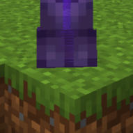

# no player shadow

removes the shadow under players. client side fabric mod. it also hides the other entity shadows right now because that is how the 1.21.11 version works.

there are 2 versions in here:

- `1.21.11` is the normal project, you can build it with gradle
- `universal` is the code of the universal jar that works on 1.15 up to 1.21.11. i lost the original project for this one so it is decompiled from the jar, the names are a bit ugly but it is the same thing

## install

you need fabric loader 0.14 or newer. download the jar from the releases page and put it in your mods folder. the universal one is the safe pick if you are not sure.

there is no settings screen yet, the values live in the cfg class.

## build

go in the 1.21.11 folder and run `./gradlew build`.

mit license.
